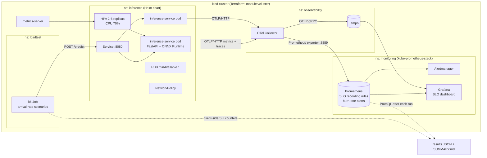

# inference-slo-platform

A Terraform-provisioned Kubernetes platform for a small ML inference service, built around one
explicit SLO. It runs a CPU digits classifier behind FastAPI, instruments it with
OpenTelemetry, and ships metrics and traces through an OTel Collector to Prometheus and Tempo.
It defines the SLO as Prometheus recording rules with multi-window burn-rate alerts and
visualises the error budget in Grafana. It then load-tests the whole stack in-cluster with k6,
including a rolling restart under load.

Everything, from the cluster to the dashboards, comes up with one `terraform apply` on a local
[kind](https://kind.sigs.k8s.io/) cluster. The same platform and app modules also have an EKS
environment, which CI validates but which has never been applied.

## Contents

- [The SLO](#the-slo)
- [Architecture](#architecture)
- [Components](#components)
- [Running locally](#running-locally)
- [Load tests](#load-tests)
- [CI](#ci)
- [Repository layout](#repository-layout)
- [Design decisions and trade-offs](#design-decisions-and-trade-offs)
- [Limitations](#limitations)

## The SLO

> **99% of `POST /predict` requests succeed (non-5xx) in 300 ms or less, over a rolling 28 days.**

| | Definition |
| --- | --- |
| Good event | `/predict` response with a non-5xx status and latency at or under 300 ms (`le="0.3"` histogram bucket) |
| Total events | Every `/predict` request. 4xx responses are client errors and count as good if they are fast |
| SLI (error ratio) | `1 - good / total`, recorded for 5m, 30m, 1h, 2h, 6h, 1d, 3d and 28d windows |
| Error budget | 1% of requests over 28 days; `slo:error_budget_remaining:ratio = 1 - burn_rate_28d` |

The latency histogram buckets are dense around 300 ms, and 0.3 s is an exact bucket boundary.
So the SLI is a direct bucket ratio, not an interpolated percentile.

**Alerts** follow the multi-window, multi-burn-rate pattern from chapter 5 of the Google SRE
Workbook. Both windows must exceed the burn-rate threshold, so an alert fires quickly on a real
burn and resets quickly once it stops.

| Alert | Burn rate | Windows | `for` | Severity |
| --- | --- | --- | --- | --- |
| `InferenceSLOBurnRateCritical` | 14.4x (2% of the 28d budget per hour) | 1h and 5m | 2m | page |
| `InferenceSLOBurnRateHigh` | 6x (5% of the budget per 6h) | 6h and 30m | 5m | page |
| `InferenceSLOBurnRateLow` | 1x (budget runs out before the window ends) | 3d and 6h | 30m | ticket |
| `InferenceSLONoTraffic` | metric absent: the SLI cannot be computed | 10m | 10m | ticket |

The rules live in plain Prometheus format in
[`charts/inference-service/files/slo-rules.yaml`](charts/inference-service/files/slo-rules.yaml).
The Helm chart wraps them in a `PrometheusRule`, and
[`promtool` unit tests](charts/inference-service/tests-promtool/slo-rules.test.yaml) check that
each alert fires, and stays quiet, on synthetic series.

## Architecture



Metrics are pushed by the SDK rather than scraped from the pods. The Collector turns resource
attributes (service name and version, pod, namespace, node) into metric labels and exposes them on a
Prometheus endpoint, which Prometheus scrapes every 15 s. Traces are sampled at 10% (parent-based
ratio sampler) and go to Tempo, which Grafana has as a data source.

## Components

**Inference service** ([`service/`](service)). A FastAPI app serving a scikit-learn random
forest trained on the bundled 8x8 handwritten digits dataset and exported to ONNX.
- `POST /predict` takes a batch of up to 32 flattened images (64 pixels, values 0-16). Input
  is validated by Pydantic, and oversized batches get a 422.
- `GET /healthz` is liveness. `GET /readyz` is readiness: it reports ready once the model is
  loaded and warmed up, and not ready while the pod is draining.
- **RED metrics** come from a small ASGI middleware: request duration by route, method and
  status, plus in-flight requests. Unknown paths collapse into one `other` route to bound
  cardinality.
- **Model metrics**: model inference time and batch size histograms, plus a `model.predict`
  span on each request.
- **Image**: three-stage Docker build. The model is trained in the first stage, so the runtime
  image contains only ONNX Runtime and never ships scikit-learn. It runs as non-root on a
  read-only root filesystem.
- **Shutdown**: uvicorn's graceful-shutdown timeout is derived from the pod's termination
  grace period minus the preStop sleep, minus 5 s of margin. Telemetry is flushed on exit.

**Helm chart** ([`charts/inference-service/`](charts/inference-service)).
- Deployment with startup, readiness and liveness probes, and a rolling update with
  `maxUnavailable: 0` and `maxSurge: 1`.
- Pods are spread across nodes by hostname topology. A configurable preStop sleep is set by
  `preStopSleepSeconds`, default 0.
- HPA (2-6 replicas on CPU) and a PodDisruptionBudget.
- A NetworkPolicy allows ingress only from the `loadtest` and `monitoring` namespaces, and
  egress only to DNS and the Collector's OTLP port.
- The `PrometheusRule` holding the SLO rules.

**Terraform** ([`terraform/`](terraform)).

| Module / environment | What it creates |
| --- | --- |
| `modules/cluster` | kind cluster: one control plane plus N workers (default 2), so the PDB, spread and rolling restarts behave like a real cluster |
| `modules/platform` | Namespaces, metrics-server, kube-prometheus-stack (Prometheus, Alertmanager, Grafana with a generated admin password), Tempo, OpenTelemetry Collector |
| `modules/app` | App and loadtest namespaces, side-loads the locally built image into kind, Helm release of the chart, Grafana dashboard ConfigMap |
| `environments/local` | Wires the three modules together on kind |
| `environments/aws` | VPC + EKS from the community modules, plus the same `platform` and `app` modules. Validated in CI, never applied ([notes](terraform/environments/aws/README.md)) |

**Grafana dashboard**
([`terraform/modules/app/dashboards/inference-slo.json`](terraform/modules/app/dashboards/inference-slo.json)).
It has three sections:
- **SLO**: 28-day SLI, error budget remaining, burn rate by window, firing alerts.
- **Traffic (RED)**: rate by status, bad-request ratio, server-side latency percentiles,
  in-flight requests, model time.
- **Saturation**: CPU against request and limit, CFS throttling, HPA replicas, restarts,
  memory, and Collector accepted or refused points.

## Running locally

Requirements: Docker, kind, kubectl, Helm, Terraform 1.9 or later, Python 3, `envsubst` and
`jq`. The platform runs Prometheus, Grafana, Tempo and the Collector alongside the service,
so give Docker a few CPUs and several GB of memory.

```bash
make up                      # build image, terraform apply (cluster + platform + app), smoke test,
                             # wait until /predict metrics reach Prometheus
make grafana                 # prints the admin password, port-forwards http://localhost:3000
make prometheus              # port-forwards http://localhost:9090

make load SCENARIO=steady    # one k6 scenario in-cluster, results in results/local/
make load-all                # all four scenarios, then a summary table

make test                    # service unit tests (pytest) + promtool SLO rule tests
make lint                    # ruff, mypy (strict), terraform fmt, helm lint --strict
make down                    # terraform destroy
```

To call the service by hand, run [`scripts/smoke.sh`](scripts/smoke.sh). It starts a pod in
the `loadtest` namespace and calls `/readyz` and `/predict` through the Service. Requests
must come from inside the cluster, because the NetworkPolicy only admits the `loadtest` and
`monitoring` namespaces.

## Load tests

k6 runs inside the cluster as a Kubernetes Job ([`loadtest/`](loadtest)), so the test measures
the Service path rather than a port-forward. It uses **arrival-rate executors**: an open
model in which k6 keeps sending at the target rate even when the service slows down. Overload
therefore shows up as latency, errors and dropped iterations instead of being hidden by a
closed loop.

| Scenario | Shape |
| --- | --- |
| `steady` | Constant `RATE` req/s for `DURATION` (default 4m) |
| `ramp` | `RATE` for 30s, ramp to `PEAK` over 4m, hold `PEAK` for 1m |
| `spike` | `RATE` for 1m, jump to `PEAK` in 10s, hold 2m, drop back, hold 1m |
| `rollout` | `steady` load with `kubectl rollout restart` triggered after `ROLLOUT_AFTER` seconds |

Tunables: `RATE`, `PEAK`, `DURATION`, `BATCH` (images per request), `ROLLOUT_AFTER`, `SETTLE`.
Before each scenario, `wait_for_baseline.sh` waits for the HPA to scale back to its minimum, so
scenarios do not inherit each other's replicas.

**The SLI is measured from both sides.** The server can only count requests it received. A
connection refused or reset during a rollout never reaches its histogram. So k6 also counts the
SLI itself, splitting bad events into slow, 5xx and transport errors. After each run,
[`collect_results.py`](scripts/collect_results.py) queries Prometheus for the run's window
(server-side SLI, burn rates, latency percentiles, CPU throttling, replicas, restarts). It
merges that with the k6 summary, and
[`summarize_results.py`](scripts/summarize_results.py) prints one Markdown table comparing
server and client views per scenario.

## CI

| Workflow | Runs on | What it does |
| --- | --- | --- |
| [`ci`](.github/workflows/ci.yml) | every push | **service**: ruff, ruff format, mypy strict, pytest. **terraform**: `fmt -check`, `validate` for both environments. **manifests**: promtool `check` and `test` on the SLO rules, `helm lint --strict`, kubeconform on the rendered chart (CRDs included) and the k6 Job, dashboard JSON sanity check, script syntax. **image**: Docker build, then run the container read-only and smoke-test `/readyz` and `/predict` |
| [`e2e`](.github/workflows/e2e.yml) | push to `main`/`dev`, or manual with custom scenarios, rate, peak and batch | Provisions the full platform on kind with Terraform, smoke-tests through the Service, waits for the metrics pipeline, runs the load scenarios, writes the summary table to the job summary, uploads results and diagnostics as an artifact, and destroys everything |

Measured results for each run are in the e2e job summary and the `e2e-results-<run id>`
artifact on the [Actions tab](https://github.com/xeeshan16/inference-slo-platform/actions/workflows/e2e.yml).

## Repository layout

```
service/                   FastAPI app, ONNX model wrapper, OTel setup, training script, tests, Dockerfile
charts/inference-service/  Helm chart, SLO rules (files/slo-rules.yaml), promtool tests
terraform/modules/         cluster (kind), platform (observability stack), app (release + dashboard)
terraform/environments/    local (kind) and aws (EKS, validate-only)
loadtest/                  k6 script and Job template
scripts/                   smoke test, metric/baseline waits, load-test runner, result collection
.github/workflows/         ci and e2e
```

## Design decisions and trade-offs

**An availability-plus-latency SLI from histogram buckets.** One SLI covers both "it failed" and
"it was too slow", which matches what a caller experiences. Counting a request as good only if it
is non-5xx and lands in the `le="0.3"` bucket makes the SLI an exact ratio of counters. The cost
is that the threshold is tied to the bucket layout: moving the target to 250 ms means changing
the buckets too.

**Multi-window, multi-burn-rate alerts instead of threshold alerts.** Alerting on "p99 > 300 ms"
pages on brief blips and says nothing about the budget. Burn-rate alerts page in proportion to
how fast the budget is being spent, and the short window makes them reset quickly once the burn
stops.

**Push via the OTel Collector instead of scraping pods.** The service only speaks OTLP, so it is
vendor-neutral: pointing the Collector elsewhere changes the backend without touching the app.
The cost is an extra hop, and an extra failure mode, between the app and Prometheus. That is why
there is a no-traffic alert and a Collector accepted/refused panel.

**An open-model load generator, measured from the client too.** Closed-loop load tests slow down
with the service and under-report overload. Counting the SLI in k6 as well as on the server
exposes requests that never reached the server, for example during a rolling restart.

**A deliberately small model.** The digits classifier is tiny and CPU-only, so the platform, not
the model, is the subject. Training happens in the image build, so the image is reproducible and
needs no artifact store.

**kind first, cloud second.** The whole loop, from provisioning to load test and teardown, runs on
a laptop or a CI runner at no cost. The EKS environment reuses the same platform and app modules
to show the cloud path, but applying it creates billable resources, so it is only validated.

## Limitations

- **The EKS environment has never been applied.** It is checked with `terraform validate` only.
- **Long SLO windows exceed the default retention.** Prometheus retention defaults to `2d`, so
  the 3-day and 28-day windows (and the error budget derived from the 28-day burn rate) only
  cover the data that is retained. An e2e run lasts minutes, so its SLO numbers describe that
  run, not a month of production.
- **Runbook links are dangling.** The alert annotations point to `docs/runbook.md` on `main`;
  neither exists yet.
- **Autoscaling is CPU-based only.** The HPA does not use request rate or latency.
- **No ingress, TLS or authentication.** The service is cluster-internal, and access is limited
  by the NetworkPolicy alone.
- **Single Collector replica.** A Collector restart drops telemetry for that period.
- **Alerts route nowhere.** Alertmanager is installed but has no receivers configured.
